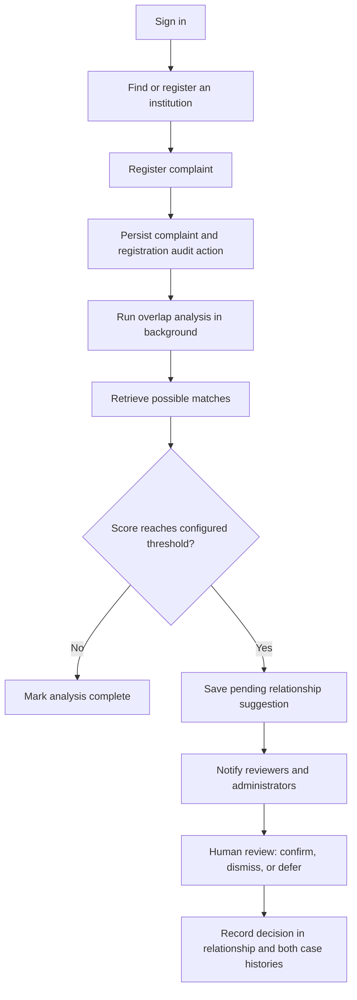

# PS 26264 — Complaint Case Intelligence

A local dashboard prototype for managing institution complaint histories, tracking case actions, finding potentially related complaints, and reviewing suggested relationships. All bundled accounts and complaints are synthetic. The prototype is not connected to live AICTE systems.

## How the application works

The project runs as a small web application with two processes:

- **Web client:** React, TypeScript, and Vite provide the dashboard, complaint explorer, registration forms, institution profiles, search, notifications, and reports.
- **API and services:** Express and TypeScript handle authentication, validation, authorization, complaint workflows, overlap analysis, and reporting.
- **Local data store:** Node's built-in SQLite adapter persists complaints, users, institutions, case actions, relationships, notifications, and embeddings in one local database file.
- **Optional AI providers:** OpenAI-compatible embedding and chat-completion endpoints can be configured. The application works without them using keyword matching for search and overlap retrieval.

The browser sends API requests to `http://localhost:4000/api/v1` by default. The API applies authorization and scope checks before reading or changing records; the client is not the security boundary.

## Main complaint workflow



### Register and process a complaint

An authorized user selects an active institution and provides the received date, bureau, category, subject, description, priority, and optional assignment, target date, and next action. The API validates the request, enforces bureau and regional restrictions, generates a case ID, saves the complaint, and records a `COMPLAINT_REGISTERED` audit action.

A case then moves through validated statuses:

```text
PENDING → UNDER_PROCESS → TRANSFERRED → UNDER_PROCESS
                       ↘ ESCALATED → UNDER_PROCESS
                       ↘ DISPOSED
```

Only allowed transitions are accepted. Assignment changes, transfers, status updates, notes, follow-ups, and escalations are recorded in the case action history with the actor and timestamp. Assignment and overlap events can also create in-app notifications. Disposed cases are excluded from active overdue totals.

### Find and review potential overlaps

After a complaint is saved, the API starts a best-effort, in-process analysis job. It first tries to embed the institution, AICTE ID, category, subject, and description. It then compares the complaint with stored cases using these signals:

- Same institution and category
- Exact reference-like text in the subject or description
- Cosine similarity between embeddings, when an embedding provider is configured
- Lexical keyword similarity when embeddings are unavailable

The signals contribute to a candidate score. Scores that meet or exceed `SIMILARITY_THRESHOLD` create a pending relationship suggestion, subject to a duplicate check for the complaint pair. `SEMANTIC_TOP_K` limits the number of retrieved candidates. These values prioritize cases for review; a score is not proof that two complaints are related.

When an LLM provider is configured, the API sends the two complaint records to it and asks for a constrained JSON comparison of similarities, differences, uncertainties, and supporting fields. The API validates the returned shape and evidence references before saving the explanation. If the LLM is not configured or its call fails, the suggestion can still be saved from retrieval signals without an explanation.

An authorized reviewer compares the source records and can **confirm**, **dismiss**, or **defer** the suggestion. A confirmation records a relationship between the cases; it does not merge complaints, alter their status, or make an official decision about either complaint. Review decisions are also appended to both case histories. Only administrators and reviewers can make these decisions; regional officers can view suggestions within their region.

The demo seed includes a sample pending cross-bureau relationship and notification, so the review workflow can be explored without configuring AI services.

### Search, dashboards, and reports

For semantic search, results are ranked by cosine similarity. Results below `SEARCH_SIMILARITY_THRESHOLD` are omitted, then the remaining matches are capped by `SEMANTIC_TOP_K`. Tune this minimum for the selected embedding model; the default is a starting point, not a universal relevance score.

The complaint search page offers:

- **Semantic mode:** Uses an embedding endpoint and locally computes cosine similarity. If embeddings are unavailable, it returns keyword matches and labels the fallback.
- **Keyword mode:** Searches case IDs, subjects, descriptions, and institution names using text matching.

Dashboard and report metrics are calculated from persisted records. The reports page includes case counts, overdue cases, status and bureau summaries, ageing, overlap outcomes, and complaint CSV export. Institution profiles show authorized complaint history and summary counts.

## Architecture and implementation decision

The proposed design describes a modular monolith using React, Express, MongoDB Atlas/Vector Search, and backend-mediated AI calls. This runnable prototype keeps the frontend/API/service boundaries but uses Node's built-in SQLite adapter as its local operational store. MongoDB Atlas, Atlas Vector Search, and a Mongoose adapter are not implemented. Embeddings are stored in SQLite and ranked locally with cosine similarity.

```text
web/                  React UI, API client, charts
server/src/index.ts   Express routes, auth/RBAC, complaint workflows, reports
server/src/db.ts      SQLite schema and indexes
server/src/ai.ts      Embedding, retrieval, evidence-bound LLM comparison
server/src/seed.ts    Synthetic demo records and accounts
scripts/smoke.ps1     Read-only API smoke checks
```

## Requirements

- Node.js 22+ (uses the built-in `node:sqlite` module).
- npm 10+.
- No external database is needed for local use.
- Optional: OpenAI-compatible embeddings and chat-completion endpoints. Ollama can be used if configured with compatible endpoints and models.

## Setup and run

Run these commands in PowerShell from the project root:

```powershell
# Create .env only if it does not already exist; this avoids overwriting your settings.
if (-not (Test-Path .env)) { Copy-Item .env.example .env }
npm install
npm run seed
npm run dev
```

Open <http://localhost:5173>. The REST API listens at <http://localhost:4000/api/v1>. If either port is already in use, stop the earlier project process or use the URL/port printed by Vite; only one API process can listen on port 4000 at a time.

The seeded accounts all use password `Demo@26264`:

| Role | Email | Access summary |
|---|---|---|
| Reviewer | `reviewer@demo.aicte.local` | Broad complaint visibility; can review and decide overlap suggestions |
| Administrator | `admin@demo.aicte.local` | Broad access; can manage users and institutions and review suggestions |
| PGRC bureau officer | `officer.pgrc@demo.aicte.local` | Complaint access limited to PGRC |
| Regulation bureau officer | `officer.reg@demo.aicte.local` | Complaint access limited to Regulation |
| Read-only viewer | `viewer@demo.aicte.local` | Read-only access limited to the North region |

The seed is repeatable and does not duplicate its known synthetic records. The first run creates `server/data/ps26264.db` (or the path selected by `DATABASE_PATH`). Keep this file to preserve new complaints and actions. To intentionally reset to a clean demo, stop the server, remove the database file and its SQLite `-wal`/`-shm` sidecars, then run `npm run seed` again.

## Environment settings

Copy `.env.example` to `.env` if needed. AI settings can be left blank; the app then reports AI as unavailable and uses keyword fallback where supported.

| Setting | Purpose |
|---|---|
| `PORT` | API port; defaults to `4000` |
| `DATABASE_PATH` | SQLite database path |
| `WEB_ORIGIN` | Allowed browser origin; defaults to `http://localhost:5173` |
| `JWT_SECRET`, `JWT_EXPIRES_IN` | API token signing and lifetime; use a long random secret outside local development |
| `EMBEDDING_BASE_URL`, `EMBEDDING_API_KEY`, `EMBEDDING_MODEL` | Optional OpenAI-compatible embedding endpoint, bearer key, and model. The API root is used; the app appends `/embeddings`. |
| `LLM_BASE_URL`, `LLM_API_KEY`, `LLM_MODEL` | Optional OpenAI-compatible chat endpoint, bearer key, and model. The API root is used; the app appends `/chat/completions`. |
| `AI_TIMEOUT_MS` | Timeout for embedding and LLM requests; defaults to `12000` ms |
| `SEMANTIC_TOP_K` | Maximum candidates returned by vector retrieval; defaults to `8` |
| `SEARCH_SIMILARITY_THRESHOLD` | Minimum cosine similarity for semantic search results; defaults to `0.35` |
| `SIMILARITY_THRESHOLD` | Minimum overlap candidate score to create a suggestion; defaults to `0.35` |

For example, with OpenAI-compatible services, the endpoint root is commonly `https://api.openai.com/v1`; use a model supported by your account. Keep API keys in `.env`, do not commit them, and remember that complaint text is sent to the configured provider for embedding or comparison. The prototype is intended for synthetic demo records, not real complaint data.

`EMBEDDING_DIMENSIONS` and `VECTOR_INDEX_NAME` remain in the sample env file for planning purposes; the current SQLite implementation does not use them. This is not Atlas Vector Search.

## API overview

All routes are under `/api/v1`. Health and login are public; other routes require a bearer token. Zod validates request bodies, and the API checks user roles and bureau/region scope on protected operations.

| Area | Routes |
|---|---|
| Auth | `POST /auth/login`, `POST /auth/logout`, `GET /auth/me` |
| Users | `GET /users`, `POST /users` (admin) |
| Institutions | `GET/POST /institutions`, `GET/PATCH /institutions/:id`, `GET /institutions/:id/complaints`, `GET /institutions/:id/summary` |
| Complaints | `GET/POST /complaints`, `GET /complaints/:id`, `PATCH /complaints/:id/assignment`, `PATCH /complaints/:id/status`, `POST /complaints/:id/transfer`, `POST /complaints/:id/actions`, `GET /complaints/:id/actions` |
| Analysis | `POST /complaints/:id/analyze-overlaps`, `GET /complaints/:id/overlap-suggestions`, `POST /search/complaints` |
| Review | `GET /overlaps`, `GET /overlaps/:id`, `POST /overlaps/:id/confirm`, `/dismiss`, `/defer` |
| Dashboard | `GET /dashboard/summary`, `/dashboard/bureau-workload`, `/dashboard/pendency` |
| Operations | `GET /notifications`, `PATCH /notifications/:id/read`, `GET /reports/complaints`, `/reports/overlaps`, `GET /audit-logs` |

Complaint listing supports `page`, `limit`, `q`, `status`, `bureauId`, `category`, and `institutionId`. Search accepts `{query,mode,filters}`. API access rules are enforced on the server; demo roles are intentionally simple and should be reviewed before real use.

## Seed scenario

The synthetic data covers institutions in the North, South, and West regions; complaint records across PGRC and Regulation; varied categories, statuses, and due dates; a sample relationship for human review; and a reviewer notification. Two complaints describe delayed graduation documents with different wording. A faculty-advertisement case at the same institution provides an unrelated comparison. Fresh AI-generated suggestions depend on optional providers and configured thresholds.

## Build and checks

```powershell
npm run build
npm run seed
npm run smoke
```

`npm run smoke` is a read-only API integration smoke check; start the API first with `npm run dev` or `npm start`. It checks login, persisted dashboard and institution reads, overlap queue authorization, keyword fallback, and logout revocation. Build success checks TypeScript compilation and frontend bundling; it does not cover all acceptance criteria. Automated unit and frontend suites remain deferred.

## Deployment notes and limitations

- This is a local prototype, not a production-hardened system. Demo credentials and synthetic records must not be reused in deployment.
- MongoDB Atlas, Atlas Vector Search, and a Mongoose storage adapter are not implemented.
- Without embeddings, semantic search and overlap retrieval fall back to keyword similarity; lexical similarity is not semantic retrieval.
- Without an LLM provider, overlap suggestions still use matching signals but have no generated explanation.
- Analysis runs in-process after the API response. There is no durable queue, retry worker, scheduled deadline scan, or deadline notification generator. Failed analysis can be retried from the complaint detail page.
- `ANALYSIS_RETRY_LIMIT` and `NOTIFICATION_SCHEDULE_MINUTES` are planning settings; the current lightweight analysis job does not implement durable retries or scheduled deadline notifications.
- Attachments, production-grade regional resource restrictions, refresh-token invalidation, comprehensive account administration UI, and live-system integration are deferred.
- The initial package installation reported npm audit findings; review dependencies before deployment.
